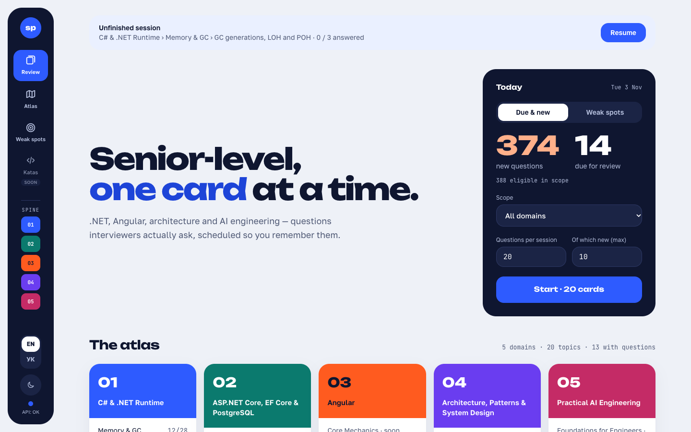
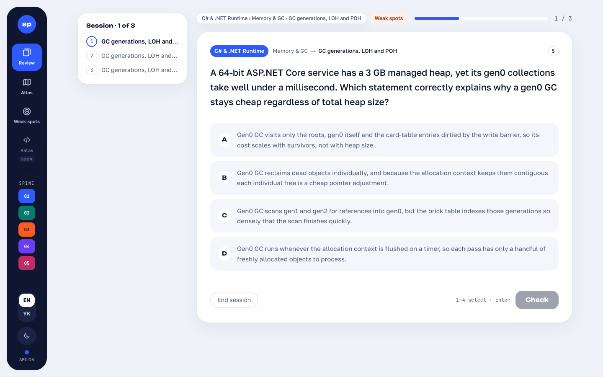
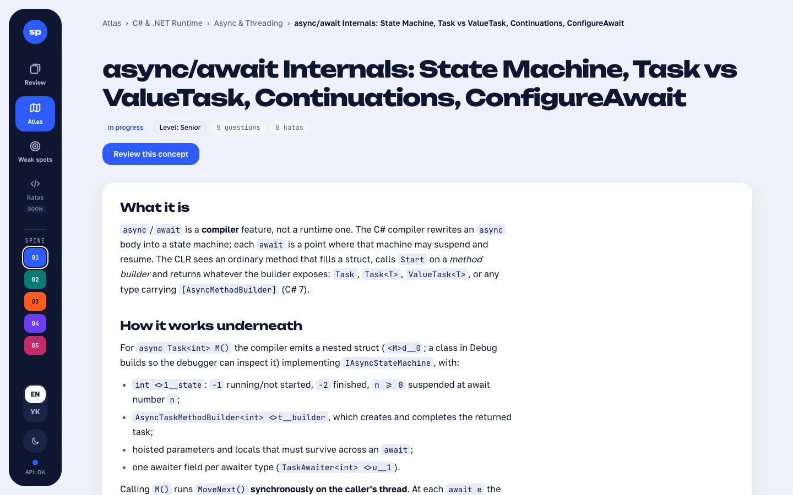
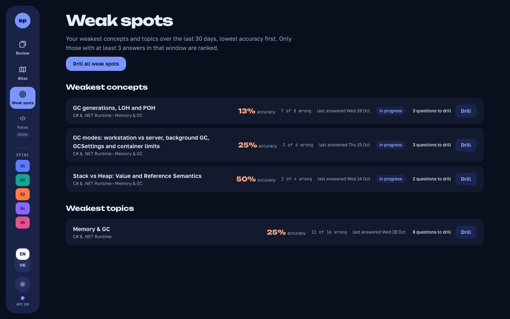
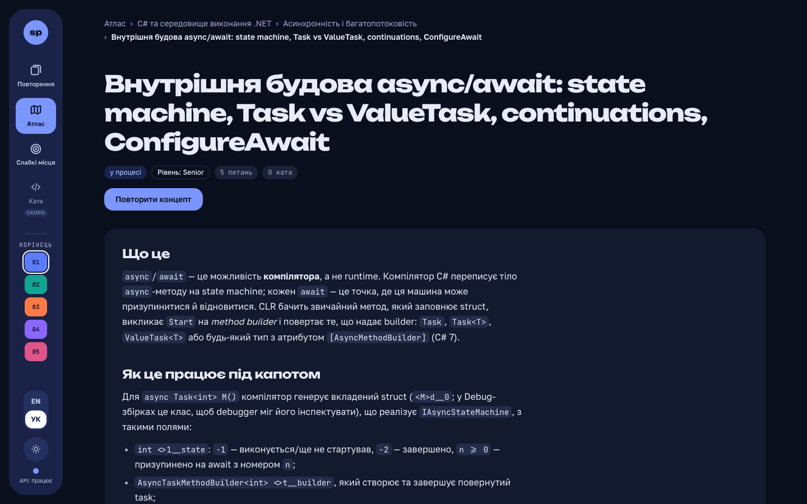
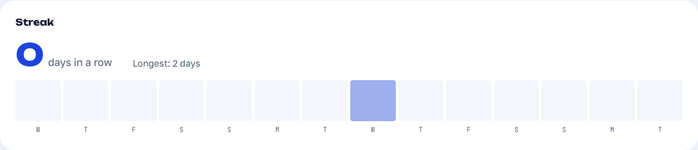

<div align="center">

# Spine

**The senior engineer's interview atlas.**

Spaced-repetition interview prep for Senior Full-stack engineers — .NET, Angular, architecture and
AI engineering — built spec-first with Claude Code and gated by [Lockflight](https://github.com/lockflight/lockflight).




</div>

## What it is

Spine is a single-user, locally run study platform. It turns a curated knowledge graph
(**domain → topic → concept**) into short review sessions and schedules every question with **SM-2**, so
the things you keep getting wrong come back sooner and the things you know stop eating your time.

Most of the value is in the content: questions written to match what interviewers actually ask, each
with a Markdown concept note that explains the *why* underneath. The content is plain JSON, generated
with AI from a fixed taxonomy and **reviewed by a human** before it counts. Anything unreviewed carries a
visible badge in the app.

| | |
|---|---|
|  |  |
| **Review sessions** — MCQ cards, keyboard-first, scoped to everything, a domain, a topic or one concept. | **Atlas** — browse every concept with its note, readiness and a one-click review of just that concept. |
|  |  |
| **Weak spots** — the concepts and topics you miss most over the last 30 days, with a drill for each. | **EN / УК, light / dark** — runtime language switch with per-item English fallback, two accessible themes. |

## Features



- **Spaced repetition** — SM-2 behind an `ISchedulingAlgorithm` interface, due + new limits per session.
- **Scoped review** — all content, a domain, a topic or a single concept; the scope lives in the URL.
- **Weak-spots mode** — drill every question whose latest answer was wrong; ranking by 30-day accuracy.
- **Streak and activity** — current and longest streak plus the last 14 days of answers, in your own time zone.
- **Knowledge atlas** — domain → topic → concept pages with safe Markdown notes and highlighted code.
- **Readiness** — per-concept progress: a question counts once its review interval reaches 7 days.
- **Bilingual** — English is canonical; Ukrainian is a separate translation pass with visible fallback.
- **Content as data** — JSON Schema–validated seed files, idempotent import, soft deprecation.
- **One command to run** — PostgreSQL, API and web with health checks via Docker Compose.

## Content

| Domain | Status |
|---|---|
| 01 · C# & .NET Runtime | 4 topics with questions; `clr-memory` and `async` reviewed and translated |
| 02 · ASP.NET Core, EF Core & PostgreSQL | 5 topics with questions, awaiting review |
| 03 · Angular | planned |
| 04 · Architecture, Patterns & System Design | 4 topics with questions, awaiting review |
| 05 · Practical AI Engineering | planned |

In total: 90 concepts, 479 questions, 7 katas. The scope is fixed by
[`specs/000-taxonomy.md`](specs/000-taxonomy.md); the contract is in [`content/schema/`](content/schema/).

## Quick start

Requires Docker.

```bash
git clone https://github.com/bohdan-ivaniichuk/spine.git && cd spine
cp .env.example .env                          # set POSTGRES_PASSWORD
docker compose up --build -d                  # postgres + api (:8080) + web (:80)
docker compose run --rm api import-content    # validate and import content/ (idempotent)
```

Open <http://localhost>. No API key is needed: the Anthropic key is only for the planned LLM grading.

## Architecture

```
web/  Angular 22 · zoneless · signals · httpResource · Tailwind 4 · Vitest   ── nginx ──┐
                                                                                         │ /api
src/  Api            FastEndpoints 8 endpoints, import-content CLI verb        ◄─────────┘
      Infrastructure EF Core 10 + Npgsql, migrations, content importer
      Application    use cases, session planner, readiness, weakness ranking
      Domain         entities, SM-2, scheduling interface
content/            JSON seed files + JSON Schemas + manifest
```

A modular monolith on .NET 10 with strict inward layering (Domain ← Application ← Infrastructure ←
Api) and a PostgreSQL database. Design decisions are recorded as ADRs in
[`docs/architecture/decisions/`](docs/architecture/decisions/); versions and conventions are in
[`docs/architecture/STACK.md`](docs/architecture/STACK.md).

## How it is built

Spine is also an experiment in **AI-augmented, spec-driven development**:

- **Constitution** — ten binding principles in [`.specify/memory/constitution.md`](.specify/memory/constitution.md)
  (content over platform, LLM only where judgment is needed, thin backend, modern Angular, …).
- **[Spec Kit](https://github.com/github/spec-kit)** — every feature goes specify → clarify → plan → tasks
  → implement in [`specs/NNN-*/`](specs/).
- **Claude Code** — project agents (architect, reviewers, test author, content author, debugger),
  skills and hooks in [`.claude/`](.claude/); the operational guide is [`CLAUDE.md`](CLAUDE.md), the
  living project state is in [`memory-bank/`](memory-bank/).
- **[Lockflight](https://github.com/lockflight/lockflight)** — gates decide when work is done: spec and
  task approvals, test-first red/green evidence, protected policy files, and format/build/test gates
  locally and in CI ([`.lockflight/`](.lockflight/), [`lockflight.yaml`](lockflight.yaml)).

| Feature | Spec |
|---|---|
| 001 Foundation — schema, import, read API, compose | [specs/001-foundation](specs/001-foundation/) |
| 002 Review session — MCQ + SM-2 | [specs/002-review-session](specs/002-review-session/) |
| 003 Atlas redesign, EN/UK UI | [specs/003-atlas-redesign-i18n](specs/003-atlas-redesign-i18n/) |
| 004 Knowledge atlas and notes | [specs/004-knowledge-atlas-notes](specs/004-knowledge-atlas-notes/) |
| 006 Weak spots | [specs/006-weak-spots](specs/006-weak-spots/) |
| 007 Activity and streak — first feature built end to end under Lockflight | [specs/007-activity-streak](specs/007-activity-streak/) |
| 005 LLM grading of open answers and katas | planned |

## Develop

Prerequisites: .NET SDK 10, Node 22.22+ (`nvm use 22`), Docker.

```bash
docker compose up -d postgres
export ConnectionStrings__Default="Host=localhost;Port=5432;Database=interviewprep;Username=interviewprep"
export PGPASSWORD=<POSTGRES_PASSWORD from .env>
dotnet run --project src/Api                  # migrates, seeds the learner, :8080 with Swagger at /swagger
cd web && npm ci && npm start                 # Angular dev server on :4200, /api proxied to :8080
```

```bash
dotnet test --filter "Category!=Integration"  # unit tests
dotnet test                                   # + Testcontainers integration tests (Docker running)
cd web && npm test -- --watch=false           # web unit tests
scripts/validate-content.sh                   # content contract check, no database
```

The suite has 356 .NET tests and 188 web tests. Known debt is tracked in [`TECH_DEBT.md`](TECH_DEBT.md).

## License

[MIT](LICENSE) — code and content.
